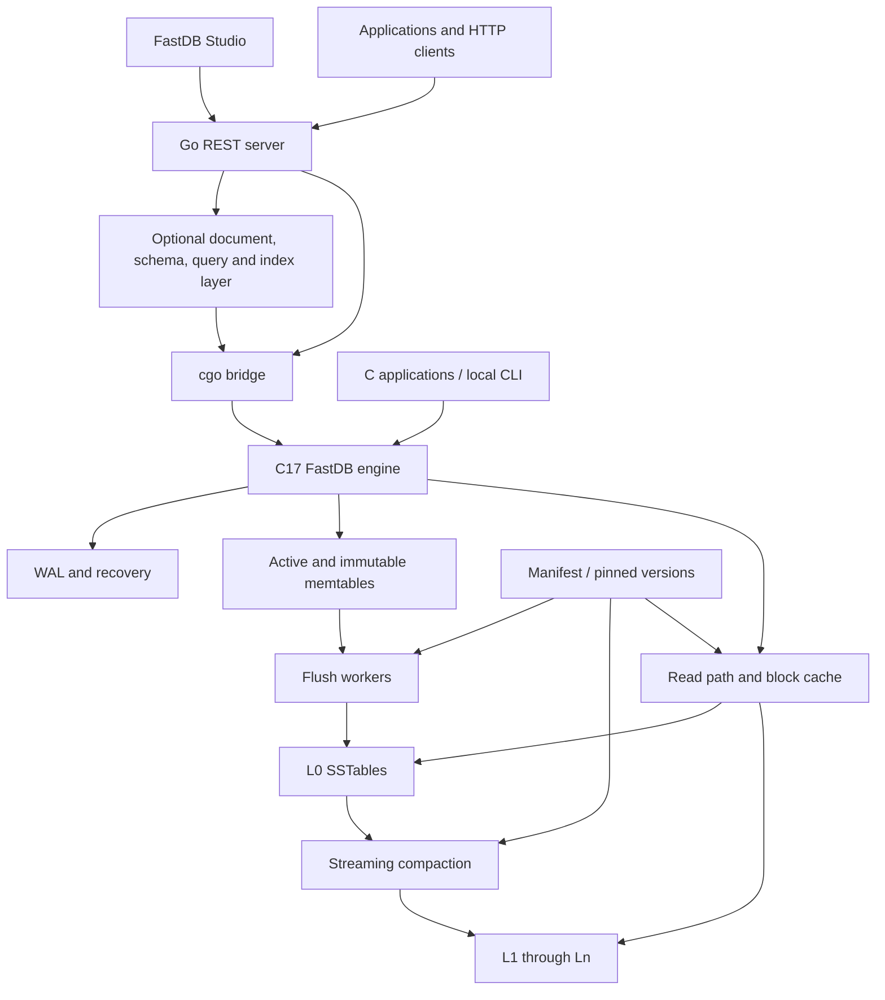

# AGENTS.md — FastDB engineering contract

> **Repository:** https://github.com/Sanu-2004/fastdb  
> **Goal:** Transform the existing C key-value database into a reliable, configurable, embeddable storage engine with an optional JSON document layer, REST server, and browser-based management studio.  
> **Companion:** `PROGRESS.md` is the durable implementation ledger. Read both files before changing code. Keep the ledger current; this file defines the intended contract, not proof that features exist.

## 1. Agent role and operating rules

Act as a principal database/storage engineer, C systems programmer, backend and frontend engineer, and test/security engineer. Work directly in the repository. Deliver real, working code and evidence, not just proposals.

- Inspect the repository, current branch, working tree, existing instructions, build scripts, source, and tests before making changes. Preserve user changes and existing licenses. Do not invent a license if none exists; record the owner decision needed.
- Reproduce the baseline build and defects in disposable directories; never test destructive behavior against user data. Record commands, outcomes, current commit, environment, and blockers in `PROGRESS.md` and `docs/INITIAL_AUDIT.md`.
- Keep FastDB's native storage engine in C. You may refactor, rename, split, or replace internal modules and formats to improve correctness; retain working components such as the red-black tree when justified.
- Implement incrementally in the dependency order in `PROGRESS.md`. Begin with the first unfinished unblocked task; do not restart the project or overwrite functioning work each session.
- Make tests part of each change. Reproduce defects with regression tests, implement fixes, run the relevant suite, investigate failures, and update the ledger before ending a session. Do not remove tests, weaken assertions, hide errors, or fake data/results to obtain a green build.
- Prefer correctness, recoverability, bounded resources, simplicity, and explicit contracts over feature count or speculative optimization. Production-oriented does not mean independently proven production-safe.
- No stubs, TODO-only public endpoints, fake UI metrics, swallowed I/O errors, unimplemented features marked complete, or fabricated test/benchmark evidence. Explicitly document unsupported capabilities. If a dependency or execution limit blocks work, continue with safe independent tasks and record the blocker.
- Keep commits coherent if committing is permitted by the user's workflow. Do not push, force-push, publish releases, change remote settings, delete branches, deploy externally, or perform destructive migration without explicit authorization. Do not discard preexisting changes. Do not commit credentials or generated database data.
- Maintain `PROGRESS.md` as the single task/status ledger; do not create a second conflicting roadmap. Use `docs/adr/` for durable architectural decisions. If an instruction is ambiguous, choose a conservative reversible option, document it, and proceed; ask only for genuinely necessary owner decisions.
- If the current session cannot finish the entire project, leave a buildable checkpoint where possible, report the actual status, and record the exact next action. Do not promise background work or assert that unrun tests passed.

## 2. Target product and boundaries

FastDB is a single-node storage engine, not a wrapper around an existing database. Build four interfaces:

1. Native C library (`libfastdb.a`, `libfastdb.so`) usable without any server or frontend.
2. CLI (`fastdb-cli`) for local, documented administration and key-value interactions; an exclusive data-directory lock prevents simultaneous independent process access.
3. Go server (`fastdb-server`) exposing versioned REST endpoints through a cgo bridge to the C engine, with optional JSON document/collection/schema/query functionality.
4. FastDB Studio, a React/TypeScript browser application using the actual REST API.

A server may manage multiple independent database instances simultaneously. Each instance has its own storage mode, budgets, configuration, lifecycle, namespaces, statistics, and permissions. Raw key-value and document modes can coexist using disjoint internal namespaces. JSON documents are optional; the C engine remains binary-safe and schema-agnostic.

Do not use RocksDB, LevelDB, SQLite, Redis, PostgreSQL, MongoDB, or any other database as the backing engine or authoritative metadata store. Maintained libraries for compression, JSON/schema parsing, cryptography, HTTP, and testing are permitted. Do not claim MongoDB or Redis protocol compatibility, distributed transactions, replication, HA, or full SQL support. They are outside the required scope. RESP, extra language bindings, and replication may be proposed separately after the release gates.

### Stack and delivery

- C17, POSIX threads and filesystem interfaces, CMake, GCC and Clang, Linux (x86-64 primary; test ARM64 when available); platform abstractions for later portability. Use 64-bit file offsets.
- Go supported stable toolchain, standard HTTP library or lightweight router, cgo, structured logging, OpenAPI 3.1. Pin supported versions in build files and docs; use lockfiles/checksums.
- React, TypeScript strict mode, Vite, Tailwind CSS, TanStack Query or equivalent, CodeMirror or Monaco. Accessible responsive design and light/dark themes.
- CTest, Go tests, Playwright, sanitizers, fuzzers, Docker/Compose, GitHub Actions. Keep the default local build free of network-dependent test services where possible.



## 3. Existing repository audit targets

The prior source review identified the following in the original `main` branch. Verify against the current checkout; code may have changed. This list is not a substitute for executing tests.

| Source | Baseline risks to reproduce or inspect |
|---|---|
| `src/db.c` | `insert` clears WALs and frees the tree even when SSTable creation fails; unchecked I/O and allocations; replay of only newest WAL; text WAL supports SET only; timestamps can collide; repeated updates inflate memory accounting; `get` ownership differs by source. |
| `src/sstable.c` | `mergeSSTables` unfinished; handles not closed and empty output may be left; unsorted directory traversal can return stale values; hierarchical offset/index boundary errors; native struct/size_t encoding; unchecked lengths and file operations; synchronous flush/compaction; no durable publication or cascading policy. |
| `src/memTree.c` | C strings, allocation failure handling, no tombstones/sequence numbers, no synchronization; verify red-black invariants and update ownership. |
| `src/main.c`, `src/repl.c` | Test data inserted by main instead of a usable CLI; inconsistent freeing; missing DELETE, argument/EOF checks, lifecycle and error handling. |
| `include/config.h` | Hardcoded path, limits, levels and tiny index fanout; replace with validated runtime options. |
| `Makefile` | No library target, test suite, sanitizer profiles or thread flags in baseline. |

Preserve existing on-disk files. Detect legacy format and refuse unsafe opens. If possible implement a read-only offline legacy export/migration utility with explicit destination and verification; if incomplete/corrupt legacy files cannot be recovered reliably, report this. Never silently reinterpret, delete or migrate original data. Test against synthetic legacy fixtures.

## 4. Non-negotiable correctness invariants

Document invariants and linearization points in `docs/ARCHITECTURE.md`, `docs/CONCURRENCY.md` and `docs/DURABILITY.md` and test them.

- Every committed mutation has an ordered, non-reused sequence number within a database incarnation. No wraparound. File creation time and directory enumeration order never determine value freshness.
- A GET observes a coherent read view: active memtable, frozen memtables, and one pinned file-catalog version. The newest visible mutation wins; a latest DELETE or expired value masks older records, never resurrects them.
- Atomic batches and conditional checks are committed as a single visibility/durability unit. Do not expose partial batches even on recovery or concurrent access. Define the status returned when a failed I/O leaves the commit outcome uncertain.
- A successful synchronous or group-commit acknowledgment means the required WAL and relevant filesystem metadata are durable under the documented filesystem assumptions. Asynchronous modes may lose recent acknowledged writes; do not promise a hard time bound if syncing stalls.
- No committed SSTable or WAL is deleted until equivalent durable state is committed and any readers that require it have finished. No reader sees a partially written file or a half-applied manifest edit.
- Corruption or I/O error must not be translated into NOT_FOUND. A malformed or corrupt Bloom filter may be bypassed only when doing so is safe and the corruption is reported; never use it to skip potentially present keys.
- Compaction must preserve the logical result, active snapshot visibility, and TTL semantics. Tombstones and old versions may be dropped only with a proof of safety; conservative retention is preferable to data loss.
- Memory, queues, file descriptors, request sizes, scans, caches and compaction working sets must be bounded by documented limits. Distinguish engine-accounted memory from process RSS/OS page cache. No implicit eviction of persistent user data.
- Thread-safe APIs must have explicit ownership, lifecycle and shutdown rules. Handle allocation/I/O failures, integer overflow, malformed input and partial initialization without leaks or use-after-free.

## 5. Storage modes and runtime configuration

Implement three modes, independently selectable per database:

| Mode | Data placement | Persistence |
|---|---|---|
| `memory` | All live data in RAM | No data WAL, SSTables, checkpoints or data persistence. No compaction. Default no eviction; return LIMIT_EXCEEDED if full. Optional LRU/LFU/FIFO only when explicitly enabled. |
| `memory_persistent` | All live data in RAM | WAL plus periodic atomic checkpoints; bounded log rotation and complete recovery. Never evict committed data implicitly. |
| `lsm` | Active/frozen memtables and disk SSTables | WAL, manifest, background flush and compaction, optional cache; dataset may exceed RAM. |

Durability-first is a profile of persistent modes, not a separate format. Presets: `cache`, `balanced`, `read_optimized`, `write_optimized`, `durable`, `low_memory`. Default persistent mode uses sync or group commit; cache uses no WAL. Mode migration is offline/explicit, not a config toggle that could lose data. Memory-only registrations may optionally be recreated empty on restart; disclose this behavior and do not write their records/schema contents to disk unless explicitly exported by the user.

The native API accepts validated options; the Go server supports YAML, environment variables, CLI overrides and supported admin changes. Document precedence, defaults and units. Reject invalid or unsupported combinations, never silently ignore options. Classify options as live-changeable, reopen-required or migration-required. File-specific format settings must be encoded in each file.

Illustrative configuration (adapt exact option names consistently and expose a machine-readable config schema):

```yaml
database:
  name: app
  path: ./data/app
  mode: lsm
  max_key_bytes: 65536
  max_value_bytes: 16777216
memory:
  memtable_bytes: 67108864
  max_immutable_memtables: 2
  max_total_memory_bytes: 536870912
  eviction_policy: none
wal:
  enabled: true
  sync_mode: group_commit
  sync_interval_ms: 100
  max_segment_bytes: 67108864
sstable:
  block_bytes: 16384
  target_file_bytes: 67108864
  compression: none
  checksum: crc32c
bloom_filter:
  enabled: true
  bits_per_key: 10
cache:
  enabled: true
  max_bytes: 134217728
  policy: lru
compaction:
  enabled: true
  strategy: leveled
  max_levels: 7
  level0_file_trigger: 4
  level1_bytes: 268435456
  level_multiplier: 10
  max_merge_inputs: 8
threads:
  flush_workers: 1
  compaction_workers: 2
limits:
  max_open_files: 256
  max_batch_operations: 10000
  max_background_memory_bytes: 67108864
server:
  host: 127.0.0.1
  port: 8080
```

Also expose limits for batch bytes, total disk usage/headroom (where supported), maximum snapshots/lifetime, requests, scan records, TTL and query resources. Configuration validation must account for worst-case concurrent memory use, oversized individual records, and index/filter builders. Allow very small thresholds for deterministic tests. Reject or safely handle a record larger than a normal block or memtable. Do not count only key/value payload bytes as total memory.

## 6. Public native API and record model

Create an opaque, versioned public C ABI (`include/fastdb/fastdb.h` plus supporting headers). Use `const void *` + `size_t` for binary-safe key/value input. A successful GET returns an owned copy with explicit size, released using `fastdb_free`. Empty values must be distinct from missing records. Define empty-key support or reject it consistently. No caller-facing internal mutable pointers.

Representative API (final signatures may be improved; document and test them):

```c
typedef struct FastDB FastDB;
typedef struct FastDBOptions FastDBOptions;
typedef struct FastDBBatch FastDBBatch;
typedef struct FastDBIterator FastDBIterator;
typedef struct FastDBSnapshot FastDBSnapshot;

FastDBStatus fastdb_open(const FastDBOptions *, FastDB **);
FastDBStatus fastdb_put(FastDB *, const void *, size_t, const void *, size_t);
FastDBStatus fastdb_get(FastDB *, const void *, size_t, void **, size_t *);
FastDBStatus fastdb_delete(FastDB *, const void *, size_t);
FastDBStatus fastdb_flush(FastDB *);
FastDBStatus fastdb_compact(FastDB *);
FastDBStatus fastdb_close(FastDB *);
void fastdb_free(void *);
```

Include options creation/defaults/destruction, status-to-string, version, exists, get-with-revision, put-with-TTL, compare-and-swap (including expected absence), conditional multi-key batches, range/prefix scans, iterators, snapshots, checkpoints, configuration and stats. Provide precise inclusive/exclusive bound, iterator ownership/error, batch atomicity, CAS, expiration, and thread-safety semantics. Statuses include OK, NOT_FOUND, INVALID_ARGUMENT, OUT_OF_MEMORY, IO_ERROR, CORRUPTION, BUSY, CONFLICT, LIMIT_EXCEEDED, UNSUPPORTED, CLOSED and an explicit uncertain commit outcome if needed. Never silently truncate data.

Internal records contain key bytes + length, value bytes + length, uint64 sequence, PUT/DELETE type, optional expiration timestamp. Encode fixed-width little-endian fields with checked arithmetic; no persisted pointer/native struct/size_t. Comparator is unsigned bytewise lexicographic with length tie-break. Use the same ordering across memtables, indexes, SSTables, merges and scans. Define internal ordering for multiple versions of one key (e.g., user key ascending, sequence descending), and verify bounds and equality. Use monotonic clocks for durations; define persistent TTL using absolute UTC time and document clock behavior. A snapshot captures both its sequence and defined expiration-read time.

## 7. Memtables, concurrency, and snapshots

Retain/refactor the red-black tree if tests verify rotations, ordering, black height, color constraints, update handling and ownership. Expose an internal memtable interface for future skip lists or trees; one verified implementation is enough for v1. Track actual allocated bytes (including arena retention, nodes and metadata). Use an optional per-memtable arena; free only when all users release it. Memory modes must physically reclaim logically deleted/expired records when safe.

Implement a simple serialized writer and coherent read-view capture first; then optimize. Use POSIX mutexes, RW locks, condition variables, atomics and reference counting as appropriate. Document lock order, linearization points, lifetime/close rules, and error states. Avoid long global locks during file I/O. A writer must preflight memory/allocations or otherwise guarantee safe handling of a durable WAL append followed by an allocation failure; never return a definitive failure for an operation whose commit outcome is uncertain without defining recovery semantics.

When active memtable reaches threshold, safely create/rotate WAL and new active tree, freeze old tree, enqueue it, and publish the new state. Frozen trees stay readable until the corresponding SSTable publication is durable. Capture active/frozen trees and catalog in one coherent read view. Limit frozen queue count and bytes; throttle/block/fail writes according to documented backpressure behavior. Wake blocked callers on errors/shutdown.

Provide bounded flush and compaction worker pools; WAL sync/group-commit worker if appropriate. Prevent simultaneous compactions from selecting conflicting input files or destination ranges. Reserve jobs and revalidate catalog state at commit. Prefer serial compaction until correctness is established. Use pinned versions and refcounted SSTable handles (or equivalent) to delay obsolete-file reclamation. Use positional I/O (`pread`) or independent file handles, not unsynchronized shared seek positions.

Snapshots must pin required history in all storage modes; a sequence alone does not recover an overwritten tree node. Implement multiversion memtable entries or a proven equivalent (e.g., pinned immutable copies with bounded memory), with tests for overwrites before and after freezing. Iterators/scans must merge all relevant visible sources, deduplicate by key, and filter tombstones/expired records. Batch mutations become visible atomically, including on snapshot reads. Provide bounded snapshot count/resources and documented release behavior. Close rejects new operations, drains or cancels workers safely, and reports durability failures. No cgo handle may be freed while requests retain it.

## 8. Write-ahead log, manifest, and crash recovery

Replace text WAL with checksummed, versioned binary records or atomic batch frames. Include magic/version, length, checksum, sequence/range, operation, lengths, TTL and data. Validate maximum frame lengths before allocating. Implement robust read/write loops, short I/O, EINTR, error propagation, and explicit sync. Use unique persistent file IDs (not timestamps); protect against reuse after crash, including orphan files. Acquire an exclusive persistent directory lock before opening any database files.

Durability policies:

- `disabled`: no WAL; unflushed data may be lost, allowed only in compatible modes.
- `async`: acknowledge without forced sync, documented loss window.
- `interval`: periodic sync, documented best-effort window.
- `sync`: acknowledge after successful required durable sync.
- `group_commit`: batch multiple mutations into one sync; acknowledge each only after the required sync.

A checksummed manifest (plus atomically managed CURRENT pointer or equivalent) is the authoritative catalog: database ID, format, file ID allocator/high-water mark, sequence high-water, recoverable WAL generations, SSTable IDs/levels/ranges/sizes/sequences, checkpoint metadata, atomic version edits. Support manifest rotation/checkpointing without ambiguity. Avoid relying on directory enumeration for committed state. Initialize WAL generations and directory entries durably before acknowledging writes that depend on them.

Flush/compaction/checkpoint publication protocol: create unique temporary outputs in same filesystem; finish/check/sync; atomic rename; sync containing directory; append and sync one manifest transaction adding outputs and removing inputs/retired WAL references; publish coherent in-memory version; retire original resources; reclaim only after pinned readers release. Preserve originals on any failure or uncertain commit; recover authoritative manifest state before reclamation. Use a fault-injectable filesystem interface. Document POSIX/filesystem assumptions and limitations for network filesystems and power-loss behavior.

On startup: lock directory, validate manifest and referenced files, replay every required WAL in order, restore sequence/file IDs, ignore only documented incomplete trailing frames, reject/report unexpected mid-log corruption, recover atomic batches completely or not at all, reconcile orphan outputs after authoritative state is known, and restore all three modes appropriately. Missing referenced files are corruption, not empty data. Persistent-memory checkpoints use the same safe publication principles; WAL deletion only after durable checkpoint coverage.

## 9. SSTables, block indexes, Bloom filters, and cache

Implement a documented binary block format with magic/version, file ID, sorted data blocks, record offsets/restarts, checksums, filter blocks, index blocks, properties, and a fixed-size footer locating metadata regions with 64-bit offsets/lengths. Properties include min/max user key and sequence, count, tombstones, sizes and compression. Encode all integers explicitly. Validate bounds, overflow, checksums, compressed/uncompressed sizes and record counts; reject malformed, truncated and unsupported versions. Optional LZ4/Zstd using maintained libraries; store codec and checksum metadata per file. CRC32C by default.

Separate `SSTableReader`, `SSTableWriter`, `SSTableIterator`, block/index/filter implementations. Writer accepts sorted records from any iterator and rejects unexpected ordering. Iterator has first/seek/valid/current/next/status/close and distinguishes EOF from error. Define borrowed record lifetime. Never directly parse raw offsets in compaction. Use bounded buffers; support oversized valid records with explicit limits.

Point lookup: catalog key-range check -> Bloom filter -> binary search sparse block index -> positional read/cache -> binary search record offsets -> newest visible record. If a key has multiple versions spanning blocks, the index/lookup must locate all relevant visible versions or preserve key-group boundaries; test this case. Hierarchical/partitioned indexes for large files must avoid unbounded metadata allocation. Keep data blocks ordered and independently iterable, even if metadata is stored separately/spooled while building.

Bloom filters are per SSTable or partition, configurable bits/key (default 10), stable hash and probe count persisted. Include tombstones and all versions that can mask older values, including expired values retained for correctness. No false negatives for valid filters. For compaction output use bounded partition builders or conservative bounded estimates. Validate and safely bypass unusable filters with diagnostics. Track filter checks/negative/positive/observed false-positive counts.

Thread-safe bounded LRU block cache keyed by database/file ID and block offset/type. Pinned blocks cannot be freed prematurely. Cache is optional and cannot determine logical existence. Measure hits, misses and memory. Partition filter/index metadata if necessary to keep memory bounded.

## 10. Streaming compaction and deletion

Implement two-way sorted merge, then K-way merge with a min-heap (`O(N log K)` record comparisons for N records and K inputs). Use one bounded input buffer per iterator and bounded output buffers, plus explicit metadata and max-record limits. Resolve all versions of a key by sequence; preserve the history needed by snapshots and TTL. Include all iterator/writer errors in the job outcome, not as EOF. Never load entire input files, output files, or arbitrarily large indexes into RAM. Split output by target size while preserving user-key range invariants; allow documented oversized key groups when necessary or enforce a safe bound.

Support leveled (default), size-tiered, disabled, manual full/range compaction. Do not implement FIFO destructive retention for persistent data unless later explicitly authorized. Leveled invariants: overlapping L0; L1+ non-overlapping ranges; choose inputs plus all overlapping destination files and required range expansion; use byte-based level thresholds and configurable L0 count, capacity multiplier and max levels. Cascade and handle last level without inventing an inaccessible level. If fan-in limits conflict with overlap closure, use a safe staged strategy rather than omit required inputs. Size-tiered may have overlapping runs and must search all relevant candidates by sequence. Manual jobs obey the same invariants.

DELETE creates a sequence-bearing tombstone in persistent modes; GET returns NOT_FOUND when the newest visible version is a tombstone. Deleting a missing key is defined and safe. Reinsert receives newer sequence. Expiration also masks older versions. Do not discard tombstones until no older version remains outside inputs and no relevant snapshot requires them. Initially retain tombstones conservatively; enable safe bottommost/full garbage collection only after proof/tests. The existence of a newer record in a mutable tree alone is not sufficient reason to drop a durable old record (especially with weak durability). Never let compaction rely on an uncommitted change. Test crashes and concurrent updates/deletes during compaction.

Implement scheduler reservations, bounded fan-in/FDs, output headroom, throttling/backpressure, metrics and safe error recovery. A failed job leaves input files authoritative. Rebuild indexes and filters for each output. Prove merge memory budget with measured workloads larger than configured RAM budget.

## 11. Server database catalog, namespaces, and collections

The Go server manages multiple independent native instances. Persist its registry (database IDs, names, paths, mode, configuration and permissions) using FastDB or an atomically managed versioned registry file, not an external database. Registry updates and directory creation/deletion need a crash-recoverable lifecycle; use explicit CREATING/READY/CLOSING/DELETING states or equivalent. Validate names, restrict all paths to a server-owned data root, prevent traversal and symlink escapes, and serialize lifecycle operations. No arbitrary paths from HTTP callers. Require explicit deletion confirmation and prevent closing or deleting a database while requests pin its handle. Ensure pure memory data is not accidentally persisted in registry, logs or metrics.

Collections are logical namespaces within a database. Use versioned, collision-free binary prefix encoding (type + stable collection ID + encoded key/document ID). Raw user keys, documents, schema metadata, indexes and system keys cannot collide or be accessed through another namespace. Use new collection IDs when names are reused; avoid resurrecting deleted data. Store schema/index metadata inside the appropriate FastDB database and apply atomic lifecycle operations. Use bounded background cleanup for large collection deletion. Define raw key/value versus document collection operations and authorization boundaries.

## 12. Document layer and optional schema validation

Implement a separate Go package, not embedded in HTTP handlers. It must also be usable directly by Go applications. Store JSON documents as binary values; keep the native C engine independent of JSON. Each document has a stable unique `_id` (generated or supplied) and a revision from the native engine. Document IDs and revisions cannot be changed by normal updates. Reject invalid JSON, ambiguous duplicate fields, excessive nesting, oversized documents and unsupported number representations; preserve integer precision (do not silently convert all numbers to float64).

Required document operations: insert with absence condition, GET, full replacement, atomic partial update, delete, bounded batch operations, filtering, projections, sorting, pagination and indexes. Support nested objects and arrays. Raw key/value functionality remains independent.

Collection schema modes:

- `schemaless`: valid JSON objects, system fields and resource constraints only.
- `strict`: reject mutations violating the active schema.
- `warn`: accept but explicitly return validation warnings.

Use a maintained JSON Schema Draft 2020-12 validator (document supported vocabulary and format assertion behavior). Support types, required/optional properties, nested objects, arrays, enumerations, additional-property restrictions, numeric/string constraints, and local references. Disable remote reference fetching by default (SSRF protection). Persist schema versions and validation mode in the collection. Provide schema create/get/replace, dry-run validation, and compatibility reports. Schema replacement must coordinate with concurrent writes via a collection lock or transactional version precondition; use a stable scan or a documented maintenance window to validate existing documents. Incompatible changes require explicit migration or a documented override; do not silently mutate or coerce data. Optional defaults are explicit, not automatic.

Example schema:

```json
{
  "$schema": "https://json-schema.org/draft/2020-12/schema",
  "type": "object",
  "properties": {
    "_id": {"type": "string"},
    "name": {"type": "string", "minLength": 1},
    "email": {"type": "string", "format": "email"},
    "age": {"type": "integer", "minimum": 18},
    "address": {"type": "object", "properties": {"city": {"type": "string"}}}
  },
  "required": ["_id", "name", "email"],
  "additionalProperties": false
}
```

## 13. Atomic partial updates, conditions and batches

Support JSON Patch (RFC 6902, JSON Pointer RFC 6901), optionally JSON Merge Patch (RFC 7396) with distinct Content-Type and documented null semantics. Add ergonomic typed update operators `$set`, `$unset`, `$inc`, `$push`, `$pull`, `$addToSet`. Define exact behavior for missing paths, arrays, null, numeric precision/overflow, path escaping, conflicting operations, and order of evaluation. Reject ambiguous paths and updates to immutable/system fields. Limit operation count and total bytes. Do not execute arbitrary expressions or user code.

Example HTTP JSON Patch (only specified fields change):

```json
[
  {"op": "replace", "path": "/address/city", "value": "Kolkata"},
  {"op": "add", "path": "/skills/-", "value": "Rust"}
]
```

Example operator request with a precondition (define final API consistently):

```json
{
  "condition": {"available_stock": {"$gte": 1}},
  "update": {"$inc": {"available_stock": -1, "reserved_stock": 1}}
}
```

Read document and revision -> evaluate condition -> apply mutations -> validate resulting complete document against pinned schema -> calculate index changes -> atomically commit conditional native batch checking revision, schema version and unique-index preconditions. Recheck on bounded retry only where the operation's semantics permit; otherwise return conflict. Native CAS and conditional batches must serialize checks and mutations at one commit point. No independent GET + unconditional PUT. HTTP If-Match/ETags support optimistic editing; protect against stale revisions including delete/recreate. Expose absence checks. Concurrent increments must not lose updates; a conditional reservation must never make available stock negative. Document that partial HTTP updates may still rewrite the whole serialized document on disk.

Native atomic write batches must limit operations and bytes, make all mutations visible at once, persist a complete atomic WAL frame or equivalent, and recover all or none. Conditional failure commits nothing. Snapshots need a coherent sequence boundary and history retention. Do not advertise general multi-statement serializable transactions unless separately implemented and proven.

## 14. Document queries and secondary indexes

Implement a bounded structured query DSL: equality/inequality, comparison, `$in`, `$exists`, AND/OR, nested fields, projection, sort and cursor-based pagination. Specify comparison rules for number/string/bool/null/missing/array, type ordering, collation and multivalue index semantics. No arbitrary executable code, unsafe regex or unbounded query results. Use an initial bounded scan implementation before adding indexes. Return execution stats and explain plan; identify unsupported plans explicitly. Use stable cursor ordering with document-ID tie-break, bind cursors to the query and collection, and define consistency/expiration (snapshot-backed or documented weak consistency). Cap scan work, sort memory, cursor resources and query runtime; respect cancellation.

Example:

```json
{
  "filter": {"age": {"$gte": 18}, "address.city": {"$eq": "Pune"}},
  "projection": ["name", "email", "age"],
  "sort": [{"field": "age", "direction": "asc"}],
  "limit": 20
}
```

Implement persistent single-field, unique, and practical compound indexes in the native keyspace. Use collision-free order-preserving encodings for index values, with document IDs for duplicate tie-breaks. Index mutations, unique checks and document mutations are atomic in one conditional batch. Unique-index race tests are mandatory. Index build/rebuild/drop uses versioned lifecycle metadata; either coordinate writers during a bounded maintenance operation or implement a correct online build with change capture and atomic publish. Never use a partially built index as authoritative. Revalidate documents and expiry when reading index entries; design TTL cleanup so stale index entries do not corrupt results or uniqueness. Verify indexed queries match scans and survive reopen. Document unsupported array/index combinations.

## 15. REST API, native bridge and operational endpoints

Build a versioned JSON REST API at `/api/v1`, with OpenAPI 3.1, examples and interactive documentation. Use base64url-encoded path keys (or another explicitly documented reversible encoding), binary-safe bodies and revision fields; avoid JSON precision loss for 64-bit counters/revisions by encoding as strings where necessary. Use consistent errors and HTTP statuses (including 400, 401, 403, 404, 409, 412, 413, 422, 429, 503 as appropriate). Return machine-readable error codes and field violations; never expose internal stack traces or secrets.

Required endpoint families (final exact paths and request/response contracts must be in OpenAPI and tested):

| Method | Path relative to `/api/v1` | Purpose |
|---|---|---|
| POST / GET | `/databases` | Create / list databases and modes |
| GET / PATCH / DELETE | `/databases/{db}` | Metadata / supported config / explicit removal |
| POST | `/databases/{db}/open`, `/close`, `/flush`, `/compact` (each a child of database) | Lifecycle and maintenance |
| GET | `/databases/{db}/stats`, `/databases/{db}/storage` | Metrics and real LSM catalog view |
| PUT / GET / DELETE / HEAD | `/databases/{db}/kv/{key}` | Binary-safe KV |
| POST | `/databases/{db}/kv/batch`, `/databases/{db}/kv/scan`, `/databases/{db}/kv/compare-and-swap` | Batch, prefix/range scan, conditional update |
| POST / GET | `/databases/{db}/collections` | Create/list collections |
| GET / DELETE | `/databases/{db}/collections/{collection}` | Metadata / drop |
| POST | `/databases/{db}/collections/{collection}/documents` | Insert |
| GET / PUT / PATCH / DELETE | `/databases/{db}/collections/{collection}/documents/{id}` | Read, replace, atomic patch, delete |
| POST | `/databases/{db}/collections/{collection}/query`, `/databases/{db}/collections/{collection}/batch` | Query / atomic document batch (or explicitly documented bounded semantics) |
| GET / PUT | `/databases/{db}/collections/{collection}/schema` | View / change schema |
| POST | `/databases/{db}/collections/{collection}/schema/validate` | Validation and dry-run |
| GET / POST / DELETE | `/databases/{db}/collections/{collection}/indexes` (DELETE by index ID) | Index lifecycle |
| POST / GET | `/databases/{db}/backups`, `/databases/{db}/checkpoints`, `/jobs/{id}` | Backup/checkpoint and async job status |
| POST | `/databases/{db}/import`, `/databases/{db}/export` or streaming equivalents | Data transfer |
| GET | `/system/info` | Version, capability information |

Also `/health`, `/ready`, `/metrics` (outside `/api/v1`); restrict sensitive metrics and system info. Add authenticated administration for user/API key management and restore into new DB. Long-running maintenance operations return job IDs; expose status/errors/progress and safe cancellation where possible. Use HTTP conditional requests, timeouts, request limits, pagination, bounded concurrency, graceful shutdown and backpressure. Provide documented idempotency keys for retryable non-idempotent writes such as increments; if supported, atomically persist operation outcome/deduplication with mutation and bound retention. Never pretend network retries are exactly-once without such evidence.

cgo bridge: correct C allocation/free, explicit lengths, status conversion, handle pinning, no prohibited retained Go pointers, no Go pointer use beyond permitted cgo calls. Avoid unbounded goroutines/blocking native calls. Define cancellation limitations (do not claim a committed write was rolled back when a client disconnects). Ensure all native API errors reach the HTTP layer appropriately. Provide tested usage samples for C, Go, Python, Java/Spring Boot, JavaScript/TypeScript; HTTP clients require no native binding.

## 16. FastDB Studio

Implement a polished real browser management interface. No backend placeholders. Use actual API responses and mark any separate development fixture/demo unmistakably. Build the frontend as an independently testable package and serve it through the Go server or a same-origin production deployment. Do not hardcode credentials or secrets into frontend builds.

Required views:

- **Dashboard:** server health, database list, mode, real or clearly labeled estimated record counts, memory/cache, disk/WAL/SSTables, read/write operations and latency, compaction, cache hits, Bloom metrics.
- **Database creation wizard:** mode, preset, memory/durability/cache/compaction settings, advanced limits, validation and clear trade-off descriptions; CRUD/lifecycle actions with explicit confirmations.
- **KV explorer:** paginated/prefix search, key/value creation/read/update/delete, TTL/revision, raw bytes/text/JSON/base64/hex with reversible edits.
- **Document explorer:** collections, table/tree/JSON view, new/replace/delete documents, nested inline field and array editing, JSON Patch/operator editor, schema errors, revisions and conflict-aware editing (never silently overwrite a newer revision).
- **Schema editor:** JSON Schema syntax/errors, mode, test sample, version, validation/dry-run, migration/compatibility report.
- **Query workspace:** structured JSON editor, filter/project/sort, execute, explain, paginated results and real execution stats.
- **Index management:** create, inspect, rebuild/drop, uniqueness, real job state.
- **Storage visualizer:** active/frozen memtables, WAL generations, level ranges/file IDs/sizes/counts/tombstones, actual compaction input/output jobs. Memory-only mode clearly shows that disk storage is disabled.
- **Administration:** flush/compact/checkpoint, backup/restore/import/export, config and permissions, job progress/error reporting, secure database deletion.

Responsive mobile/desktop layout, light/dark themes, keyboard navigation, accessible labels, focus management, loading/empty/error states, confirmations, pagination, and useful notifications. Use SSE/WebSocket or bounded polling for actual stats/job updates. Avoid rendering unbounded records or unsafe HTML from user data. Add real backend E2E tests, including schema errors and conflicting concurrent edits.

## 17. Security, backup, and operations

Bind to localhost by default. Require authentication for non-development access. If an unauthenticated local mode exists it must be explicit and refuse non-loopback binding. No default production password. Provide secure initial admin setup, API key issuance/revocation, safe password hashing with maintained libraries, secure session/token storage, role-based and database-scoped read/read-write/admin permissions. Authorize every endpoint, including stats, jobs, schema, backups and exports. Hash stored API keys appropriately; constant-time verification where applicable. Support TLS or a documented trusted reverse-proxy configuration; configure CORS and CSRF protection for cookie-based sessions; secure cookies and appropriate security headers. Limit bodies, nesting, requests, queries, response sizes and admin jobs. Prevent path traversal, symlink attacks, unauthorized namespace access, arbitrary file access, SSRF and resource exhaustion. Keep secrets/values out of logs by default. No custom cryptography. Document filesystem threat model, at-rest encryption limitations, local access, dependency risks and supported deployment topology.

Backups: consistent snapshots/checkpoints including data and required metadata/WAL; pin files or copy under safe coordination. Validate manifest/checksums/format, restore only to a new controlled directory/database, preserve schema/index/TTL metadata as documented. Stream JSON Lines and binary-safe raw imports/exports with limits and progress. Define whether import is all-or-nothing per batch or partial with explicit error reports. Memory-only export must be explicitly requested; never background-persist it. Test full restore and continued writes after restore. Do not equate backup creation with verified recoverability.

Observability: native stats and server Prometheus metrics for GET/PUT/DELETE, latency histograms, WAL sync, memtable/queue/cache bytes, flush/compaction throughput and pending bytes, per-level tables, read/write/space amplification (define units), Bloom counters, snapshots, FDs, stalls, recovery and errors. Use bounded-cardinality labels and avoid secrets. Expose true metrics only; document estimates and collection overhead. Provide structured logs, readiness and liveness, safe shutdown and storage maintenance controls.

## 18. Testing and verification contract

All tests run against disposable temp directories and real engine behavior. Use reproducible seeds and print them on failure. Test smallest thresholds to force rotations, overlapping files and multiple levels. Keep a clear distinction between smoke, unit, integration, stress, fault and benchmark results. Do not claim that process-kill testing proves power-loss safety.

| Suite | Mandatory coverage |
|---|---|
| Baseline regression | Reproduce the defects in section 3: incomplete merging; stale reads; WAL deletion on failed flush; mixed ownership; multi-WAL recovery; memory accounting; file ID collision; index boundaries and malformed metadata; missing delete. |
| Native unit | RB tree invariants after randomized operations; allocation errors; binary comparator/zero bytes/empty values; sequence overflow; binary encoding/CRC; WAL/manifest/SSTable decoding; iterator boundaries and errors; Bloom no false negatives; blocks/multiple versions; cache pinning and eviction; config validation; merge/tombstone/TTL decisions. |
| Native integration | All three modes; PUT/GET/DELETE/reinsert; range/prefix/snapshot scans; conditional batches; flush/compact/reopen across levels; multiple independent instances; max-level behavior; shutdown; persistent-memory checkpoint; disk data larger than memory budget; legacy detection. |
| Differential/model | Independent reference map plus versioned snapshot model; randomized operations (puts, deletes, gets, scans, CAS, batches, TTL with controlled clock, snapshots, flush, compact, reopen). At least 1,000,000 operations in a documented reproducible release run; smaller deterministic CI cases. Compare actual state, not internal implementations. |
| Crash/recovery | Subprocess kill/failpoints before/after WAL creation/append/sync, batch frames, memtable rotation, output write/sync/rename, directory sync, manifest edit/rotation, version publish, obsolete cleanup, checkpoints. Verify acknowledged durable operations, complete batches, no stale values and no tombstone resurrection. Model allowed weak-durability loss and uncertain operations. |
| Fault injection | ENOSPC, short read/write, EINTR, EIO, fsync/rename failures, allocation failure, missing/truncated/corrupt files, invalid lengths, invalid checksum; committed originals remain recoverable and errors aren't NOT_FOUND. |
| Concurrency | Reader/writer races, same-key updates, read during flush/compaction, coherent snapshot acquisition, concurrent CAS, batch atomicity, delete/reinsert, queue saturation, compaction conflict, shutdown during work. Record histories for small linearizability tests or verify equivalent documented guarantees. |
| Memory/large files | Dataset exceeds configured memory; bounded streaming merge with multiple large inputs; measure peak RSS and engine-accounted memory; bound filter/index metadata, FD count and worker queues; backpressure; oversized-record policy. |
| Document | Schema modes/version transitions, nested updates, JSON Patch all supported operations, typed operators, precision/overflow, invalid patches rollback, revision conflicts, atomic increments, conditional stock reservations, unique index race, scan-vs-index query equality, pagination, TTL and recovery. |
| REST/cgo | Actual server/native database, all supported routes, binary encoding, status mapping, C ownership, concurrent requests, authorization boundaries, rate/size limits, idempotent retry where supported, lifecycle/restart, jobs and backup restore. |
| UI E2E | Playwright against actual server: login, create each storage mode, key/value CRUD, schema creation/validation, nested document edit, conflict, query, indexes, flush/compaction real state, backup/restore, delete confirmation, responsive/error states. |
| Security | Path traversal/symlink and cross-DB access, invalid schema refs, unauthenticated admin access, CORS/CSRF/session settings, malformed queries, resource exhaustion, log redaction and credential handling. |
| Fuzz | WAL, manifest, SSTable, block/record decoder, config and relevant document/HTTP inputs. No unbounded allocations, crashes, OOB or unchecked arithmetic. Save reproducible regression corpus for discovered bugs. |

Configure GCC/Clang warnings (`-Wall -Wextra -Wpedantic -Wconversion -Wshadow`, adapt with justified exceptions) and project warnings-as-errors. Use separate ASan+UBSan and TSan builds; LSan where supported, Valgrind when available, static analysis (clang-tidy/clang analyzer/cppcheck), Go vet and race detector, TypeScript strict checks and ESLint. Record unsupported sanitizer/platform combinations instead of claiming coverage. Go race detector does not replace C ThreadSanitizer. Tests should run with timeouts and clean up workers/files; avoid flaky timing-dependent assertions using barriers/fake clocks/failpoints.

## 19. Performance and benchmarks

Provide `fastdb-bench` with mode, config, operations, threads, key/value size, dataset size, seed, read/write ratio, sequential/random/hot-key/negative/mixed workloads, warmup and duration. Measure throughput, P50/P95/P99/max latency, peak RSS, engine memory, file/disk bytes, read/write/space amplification, compaction rate and recovery time. Include server/patch benchmarks and varied durability settings, block/filter sizes, cache and compaction profiles. Output JSON/CSV plus human summary; report hardware, OS, compiler, build flags, config, dataset, run count and limitations. Do not invent target throughput or compare incompatible durability modes. Optional comparable RocksDB/LevelDB/Redis benchmarks use separate external programs only, not engine dependencies. Optimize with evidence after correctness gates. Record actual results under `docs/BENCHMARKS.md` or linked artifacts.

## 20. Repository structure and deliverables

Suggested organization (adjust with ADR; avoid creating empty modules simply to match this tree):

```text
fastdb/
  AGENTS.md
  PROGRESS.md
  README.md
  CHANGELOG.md
  CMakeLists.txt
  Makefile
  include/fastdb/           # stable C public API
  src/                      # core, record, memtable, allocator, wal, sstable,
                            # compaction, manifest, cache, filter, threading,
                            # filesystem, snapshot, metrics, util
  cli/
  bindings/go/              # reusable cgo bridge or documented server package
  server/                   # registry, document, schema, index, query, auth,
                            # API, jobs, metrics, OpenAPI
  studio/                   # React/TypeScript application
  tests/                    # unit, integration, concurrency, recovery, faults, fuzz
  benchmarks/
  examples/                 # C, Go, Python, Java, JavaScript
  configs/                  # validated profiles
  docs/                     # audits, architecture, file format, guarantees, ADRs
  deploy/
  scripts/
  docker-compose.yml
  .github/workflows/
```

Build artifacts: static/shared libraries, CLI, server, benchmark executable and production Studio build. Provide installation/exported CMake targets, versioned library headers/ABI, examples, container healthchecks and persistent volumes. Pin toolchains and dependencies; non-root runtime, minimal image where practical, safe file permissions, secrets via explicit secure configuration. `docker compose up --build` should start a documented local development deployment; production deployment requires explicit secure setup. Do not automatically expose to the internet.

Provide and verify equivalent commands: `make build`, `make test`, `make test-integration`, `make test-recovery`, `make test-concurrency`, `make test-sanitizers`, `make benchmark`, `make dev`, plus CMake/CTest direct commands and server/frontend test commands. If target names differ, update documentation and ledger. CI: GCC/Clang, native suite, fault/recovery, separate sanitizers, Go tests/race, frontend lint/typecheck/build/E2E, Docker build, smoke benchmarks, periodic longer stress/fuzz. Version release artifacts only after mandatory gates. Never bypass CI to release.

Documentation: README quickstart, API reference, OpenAPI, architecture, format spec (byte layout and version compatibility), concurrency/visibility, durability/failure model, config reference, migration, security, operations, backup/restore, testing, benchmarks, limits, examples, third-party licenses, real Studio screenshots. Maintain `docs/INITIAL_AUDIT.md`, `docs/adr/`, `docs/ARCHITECTURE.md`, `docs/FILE_FORMAT.md`, `docs/CONCURRENCY.md`, `docs/DURABILITY.md`, `docs/CONFIGURATION.md`, `docs/SECURITY.md`, `docs/MIGRATION.md`, `docs/BENCHMARKS.md`, and `docs/ENGINEERING_REPORT.md` (or equivalent clearly linked paths).

## 21. Execution order and acceptance gates

`PROGRESS.md` provides stable task IDs and dependencies. Execute in this order, with validated checkpoints:

1. Audit/baseline and reproducible build.
2. Native API, binary records, in-memory core, CAS and atomic batches.
3. WAL, manifest, SSTables, recovery, persistent memory.
4. Streaming compaction, tombstones, concurrency, snapshots, TTL and resource bounds.
5. Performance, cache, compression, partitioned metadata and compaction alternatives.
6. Multi-DB and JSON document/schema/update/query/index layer.
7. REST, auth, operations, backup and observability.
8. Studio and deployment.
9. Final hardening/release evaluation.

Dependencies matter: no web UI on an unreliable engine; no secondary indexes before conditional atomic batches; no tombstone collection before visibility proofs; no concurrent compaction before serial merge correctness. Bring regression and fault tests forward as features are built, not just at the end. If a milestone is too large, split into subtasks in the progress ledger while preserving stable IDs.

Final acceptance: all required task IDs DONE with evidence, all mandatory release gates PASS with exact commands/output references, all remaining limitations explicit. Demonstrate real usage in each mode, binary CRUD, multi-level compaction under memory pressure, recovery after crash/fault, concurrency correctness, optional schemas, nested atomic updates and conditional reservations, consistent indexes, REST security, Studio and backup restore. Run the million-operation differential workload, bounded-memory large dataset run, concurrent stress run, sanitizer/fuzz suites, and actual integration/E2E/deployment tests. Record unavailable tools or unverified conditions as NOT RUN/BLOCKED, never PASS.

`docs/ENGINEERING_REPORT.md` must summarize implemented functionality, original defects, decisions, exact build/test commands, results, fault/recovery evidence, benchmarks, security review, integration and deployment instructions, known limitations, remaining risks and owner decisions. Explicitly state that automated tests do not guarantee bug-free production operation and that independent review, realistic filesystem/power-loss validation, backup drills and workload testing are needed before storing irreplaceable data.

## 22. Session completion and resume protocol

Before ending every session, update `PROGRESS.md`:

- Mark each affected stable task accurately (`TODO`, `IN_PROGRESS`, `BLOCKED`, `DONE`, `DEFERRED`). Required work cannot be deferred to claim completion.
- Record changed files, decisions, exact executed commands, pass/fail/not-run results, known defects and evidence references. Include the commit if available; do not invent a commit or a test count.
- Update release gates only when their verification actually runs; stale evidence must be revalidated after relevant changes.
- Add a dated session log and a precise handoff: first next task, next command, dependencies, blockers, working-tree state, risk and where to inspect code.
- Mark a task DONE only after implementation, relevant tests and documentation are verified; partial work remains IN_PROGRESS. Reopen tasks if regression is found.

On resumption, read this file and `PROGRESS.md`, inspect actual code and working tree, verify ledger claims against tests, then continue from the first unfinished unblocked dependency. The ledger is a record of evidence, not an instruction to blindly trust old results.

**Final directive:** Build, execute, test, debug, document and verify FastDB. Do not merely describe what should be built. Correctness and recoverability always take precedence over new features or superficial polish.
